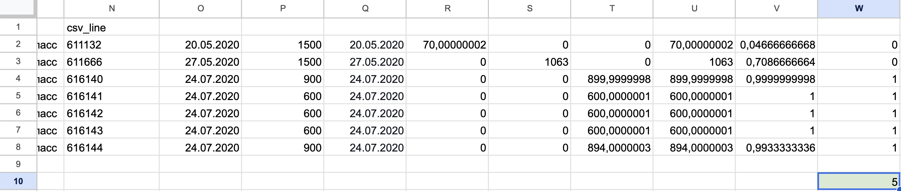
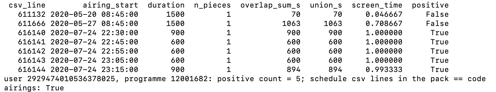
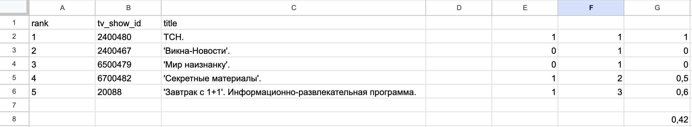
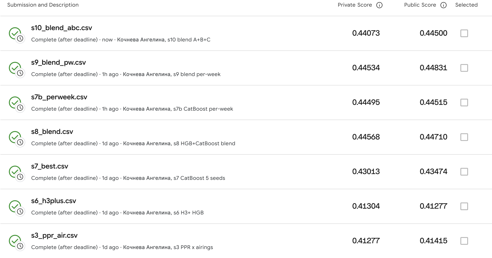

**Repository:** https://github.com/kocnevaangelina2000-wq/sweettv-tv-recommender-exam · **Final submission:** `submissions/s8_blend.csv` · **Kaggle private MAP@5 0.44568** (public 0.44710)

## Abstract

We build a Top-5 TV-programme recommender for the 1,260 test users of the Kaggle competition *sweet.tv – TV program recommender* [6]. The target counts the airings of a programme that a user watched for at least 80% of their duration.

We join 5.8 M viewing-log rows to the broadcast schedules by channel and time overlap. Screen time is the union of a user's overlapping views divided by the airing duration. Every parameter is selected on one declarative fold (A: weeks 11–15 → 16–20) and reported on another (B: 11–20 → 21–30).

We compare popularity, viewing history, implicit ALS [1], personalised PageRank [2] and content TF-IDF [3], each also weighted by the programme's airing count, against rank fusion and learned re-rankers: Poisson gradient boosting and CatBoost YetiRank [4], with hour-of-week "exposure" features.

The best single method reaches MAP@5 0.326 on fold B and 0.413 on Kaggle private. The graded file, a rank fusion of the two re-rankers fit on both folds stacked, scores 0.44568 private. Fold B ranks the strongest models differently from the leaderboard, which is the main limitation of the validation design. Two of the ten files (s9, s10) were specified after Kaggle scores were known, and the final file is the best private score, per the instructor's rule.

## I. Introduction

The task is to predict, for each of 1,260 sweet.tv users, the five programmes with the most airings watched to at least 80% of their length in weeks 31–42 of 2020. We are given the viewing log of weeks 11–30 and all schedules. The metric is MAP@5, where AP is divided by min(5, |truth|) [6].

Three properties shape the work:

1. The label counts *airings*, so frequently aired cartoons dominate, and re-watching a show is the norm.
2. Only about 11% of schedule rows carry a programme id.
3. The log has a collection gap in weeks 20–27.

Our contributions are a verified join and labelling pipeline with every data trap logged, a fold protocol that separates selection from reporting, a comparison of single and hybrid methods on that protocol, and a record of ten submissions. That record states which choices used the leaderboard.

## II. Related Work

**Implicit ALS.** Hu et al. [1] model implicit counts as confidence weights on binary preferences, using TV viewing as their own case study; we use their ALS via `implicit`.

**PageRank.** Topic-sensitive PageRank [2] biases the random walk towards a restart set. With one user as the restart set, it becomes the personalised PageRank (PPR) we run on the user–programme graph.

**Content-based filtering.** Content-based filtering with TF-IDF item profiles follows the survey of Lops et al. [3].

**YetiRank.** YetiRank [4] is the pairwise ranking loss behind CatBoost's `YetiRank` objective, which we use for per-user re-ranking.

**Top-N evaluation.** Cremonesi et al. [5] show that algorithm rankings depend on the metric and that popular items dominate top-N measurements. We therefore tune and report a rank metric, always next to a popularity baseline and on the test-user subset as well as the full cohort.

## III. Data

TABLE I. DATA ACCOUNTING (logs/stats.log, logs/audit.log)

| quantity | value |
|---|---|
| log rows / users / channels | 5,821,987 / 4,914 / 202 |
| schedule rows 11-20 / 21-30 / 31-42 | 1.07 M / 1.07 M / 1.30 M |
| labelled (id ≠ 0): rows / airtime | 10.8–11.3% / 16.0–16.9% |
| viewed seconds on labelled airings | 54.8% (11-20), 58.4% (21-30) |
| (view, airing) pairs with overlap | 7,752,415 |
| views matching no airing | 7.10% |
| positive interactions 11-20 / 21-30 | 317,043 / 294,717 |
| test users / cold (no positive) | 1,260 / 4 |

**Join.** A view and an airing match if `vsetv_id = channel_id` and the intervals [start, stop) and [start, start + duration) intersect. A per-channel `searchsorted` avoids a Cartesian merge, and it reproduced a brute-force merge on 9 channels exactly (47,116 pairs).

**Screen time and the 0.8 rule.** For each (user, airing), all of the user's overlap pieces are merged, and screen time = |union| / duration, clipped to 1. An airing is positive at ≥ 0.8. A union is needed because 2,617 users have overlapping views on one channel; summing pieces would make 4,217 extra interactions positive. The truth is the top five programmes by positive airings in the target window, with ties broken by total union seconds and then by id. The union was checked against a naive merge (38,889 groups) and on four rows by hand.

**id = 0** is unlabelled airtime. It is never recommended and never in the truth, and its seconds feed only channel-share and exposure features.

**Traps** (full table in Appendix A):

- File names and week ranges differ from the task text, and the duration column is misspelt (`duraton`).
- `user_id` exceeds int64.
- The two files use different date formats (`YYYY-MM-DD` / `DD.MM.YYYY`).
- Both files use local time, and a DST switch is uncorrected.
- Multi-device overlaps exist.
- Schedules are cut at each channel's broadcast-day start.
- Five channels are never scheduled.
- 750 of 1,150 test users tie at truth place 5/6.
- Airings are skewed: median 4 per programme, maximum 6,691.

## IV. Method

### A. Protocol
Splits are declared as (schedule file, ISO-week range) windows of the airing start:

- **A:** train 11-20 weeks ≤ 15 → target weeks 16–20; cohort 4,574 users.
- **B:** train 11-20 → target 21-30; cohort 4,643 users.
- **Final:** 11-30 → 31-42.

The *cohort* is the users with ≥ 1 positive in the target window; we report MAP@5 on it and on its test-user subset. The *pool* is the set of labelled programmes airing in the target window. The future schedule is used only to know what airs when, and already-watched programmes may be recommended.

Every parameter and model choice up to s8 is the argmax of fold-A cohort MAP@5; re-rankers use 5-fold grouped-by-user out-of-fold scores. Fold B reports each choice, with the model fit on A.

**Exactly five ids.** Each method ranks pool ids by score (ties broken by global popularity) and truncates the list at 5. Lists that are too short are topped up, without duplicates, from a *shared fallback*: pool programmes ranked by train positives × the user's watch-time share on the channels where the programme airs. Users without positives (4 test users) receive the fallback alone. An assertion checks 5 unique pool ids, and every file is validated against the template.

### B. Methods

- **Popularity:** pool programmes by train positive airings.
- **History:** the user's positive programmes by count, with recency and expected-count variants.
- **ALS [1]:** `implicit`, 150-point grid over confidence (count, log1p or BM25) × factors × regularisation × α.
- **PPR [2]:** damping α ∈ {0.3, 0.5, 0.7, 0.85}, explicit dangling mass, tolerance 10⁻⁶.
- **CBF [3]:** TF-IDF over category, genres, channels and credits, with cosine to the user profile.
- **"× air" variants:** each score is multiplied by log(1 + airings of the programme in the target schedule), because the label counts airings.

### C. Hybrids

- **H1:** history first, then PPR × air.
- **H2:** reciprocal-rank fusion Σ w/(k + rank) of four top-30 lists.
- **H3:** a learned re-ranker over the union of five top-30 candidate lists (≈ 61 per user; recall 0.69).
    - Model: `HistGradientBoostingRegressor`, Poisson loss, lr 0.01 (lr 0.1 diverged; BUGLOG B28).
    - Label: positive airings in the target window.
    - Features: history counts and recency, method scores and ranks, popularity, train and target airings, channel share, category.
- **H3+:** adds *exposure*: Σ over the programme's target airings of P(user watches that channel in that hour-of-week), estimated from train weeks. It also adds length features.
- **Step-5 variants:** an exposure candidate source with top-60 lists (recall 0.79), per-week features, CatBoostRanker YetiRank [4], seed bagging, and a rank **blend** of the HGB and CatBoost rankings.

Before any fold-B result was seen, we decided that final re-rankers are fit on A and B stacked, with label = positives per target week (5, 10 and 12 weeks in A, B and final).

### D. Settings, seeds, cost, environment
TABLE II. SELECTED SETTINGS (fold-A argmax)

| component | setting |
|---|---|
| PPR × air | α 0.5 (21 iterations) |
| ALS × air | count, 16 factors, reg 0.01, α 1 |
| H2 | all weights 1, k 10 |
| HGB | Poisson, lr 0.01, ≤ 1000 iterations, early stop |
| CatBoost | YetiRank, lr 0.03, depth 8, 500 iterations |
| s8 blend | w(HGB, CB) = (0.5, 0.5), k = 5 |

Seeds are 42, and seed bagging uses 42–46; same-seed CatBoost fits are identical.

Runtimes on fold B (4,643 users, Apple M3 Max, one BLAS thread):

| step | time |
|---|---|
| history | 0.06 s |
| ALS × air | 0.9 s |
| CBF × air | 2.9 s |
| PPR × air | 24 s |
| H3+ | 87 s |
| CatBoost × 5 seeds | 125 s |
| the s8 script, including its fold-A grid | 843 s |

Environment: Python 3.9.6 with numpy 2.0.2, scipy 1.13.1, pandas 2.2.3, pyarrow 17.0.0, scikit-learn 1.5.2, implicit 0.7.3 and catboost 1.2.8.

## V. Experiments

TABLE III. SINGLE METHODS (MAP@5; params chosen on A)

| method | A | B | B test |
|---|---|---|---|
| popularity | .2437 | .2368 | .2680 |
| history | .3239 | .3067 | .3503 |
| ALS × air | .3139 | .2904 | .3178 |
| PPR | .3388 | .3194 | .3613 |
| **PPR × air** | **.3411** | **.3256** | **.3687** |
| CBF × air | .3132 | .2987 | .3340 |

Airing weighting helps most where the base score ignores frequency: CBF +0.074 on B (base CBF: 0.2247), PPR +0.006. The fold-A pick matches the fold-B best-of-grid for every method except ALS × air. The full table and grids are in Appendix B.

TABLE IV. HYBRIDS AND RE-RANKERS (A: OOF; B: fit on A)

| model | A | B | recall B |
|---|---|---|---|
| H1 history-first | .3340 | .3141 | .61 |
| H2 RRF | .3444 | .3292 | .68 |
| H3 HGB | .3732 | .3431 | .69 |
| H3+ (+ exposure) | .3759 | .3538 | .69 |
| CatBoost ×5 (s7) | .3774 | **.3542** | .69 |
| blend (s8) | **.3783** | .3532 | .79 |

Learned re-ranking is the largest step: H3 is +0.0175 over PPR × air on B, and H3+ adds +0.011. After H3+, every fold-A gain is ≤ 0.0025, several reverse on B, and each cell is a single fit. A larger candidate set raised recall by 0.10 but not B MAP@5. In the ablation (Table C2), only removing exposure costs clearly more than noise (−0.010 on B).

**Kaggle.** All ten files are listed with what each changed in Appendix D. The key results:

| file | private | public |
|---|---|---|
| s1 popularity | 0.287 | 0.303 |
| s3 PPR × air | 0.413 | 0.414 |
| s7 CatBoost, raw counts | 0.430 | 0.435 |
| s7b, per-week counts | 0.445 | 0.445 |
| **s8 blend (final)** | **0.446** | **0.447** |

Two observations rest on one submission pair each:

1. Per-week counts (s7 → s7b) raised private by +0.0148 but were neutral on fold B. Fold B, fit on A only, never exercises the stacked final fit, whose parts differ in window length.
2. Adding fold C plus recency features (s9 → s10) lowered private by −0.0046. One plausible reason is that C's train window ends in the gap weeks, but the two changes are confounded.

Fold-A OOF orders s3 < s6 < s7 < s8 as Kaggle does; fold B does not.

## VI. Recommendation Examples

The users were picked by rules fixed before their lists were seen (DESIGN D68–D69). We draw from the 1,260 test users in the fold-B cohort, with seed 42.

- **Heavy viewer:** top 10% by train positive airings (≥ 173; 127 eligible).
- **Light viewer:** 1–3 train positive programmes.

**The first light rule produced a degenerate case.** It drew a user whose single truth programme was their single history programme (*Friends*), so every personalised method scored AP 1.0 and the example showed nothing. We therefore added a second rule: the same light-viewer condition plus ≥ 3 truth programmes in 21–30 (21 eligible), with its own seed-42 draw. We report the second draw; the first is in Appendix F.

In the tables, R = re-watch (≥ 1 positive in 11–20), T = in the 21–30 truth, f = filled by the shared fallback. Each method's fold-B MAP@5 was recomputed in the same run and matches Table III/IV.

Train history top 6: SpongeBob 103 positives, Fairly OddParents 28, Masha and the Bear 19, Alvinnn!!! 16, Факты (news) 14, Сегодня (news) 13. The full top 10 is in Appendix F. Truth: SpongeBob, Факты, Сегодня, Fairly OddParents, Alvinnn!!!.

TABLE V. HEAVY VIEWER 3086774348345899441 — 252 POSITIVES, 47 PROGRAMMES

| method | AP | top-5 |
|---|---|---|
| popular. | .35 | ТСН R · Факты RT · SpongeBob RT · Завтрак с 1+1 R · Сегодня RT |
| history | .71 | SpongeBob RT · OddParents RT · Masha R · Alvinnn RT · Факты RT |
| PPR×air | .76 | SpongeBob RT · OddParents RT · Alvinnn RT · Masha R · Факты RT |
| CBF×air | .60 | SpongeBob RT · Alvinnn RT · OddParents RT · Blaze · Penguins R |
| ALS×air | .60 | SpongeBob RT · Alvinnn RT · OddParents RT · ТСН R · Kung Fu Panda R |
| **s8** | **1.0** | SpongeBob RT · Alvinnn RT · OddParents RT · Факты RT · Сегодня RT |

Train history: two films, *Volga-Volga* (1 positive) and *SWAT* (1). Truth: Факты, ТСН, Викна-Новости (news), and the series *Однажды в Одессе* and *Мамочки*. The user had no positive on any of them in train.

TABLE VI. LIGHT VIEWER 706288898823145641 — 2 POSITIVES, 2 PROGRAMMES

| method | AP | top-5 |
|---|---|---|
| popular. | .40 | ТСН T · Факты T · SpongeBob · Завтрак с 1+1 · Сегодня |
| history | 0 | Volga-Volga R · SWAT R · Criminal Minds f · CSI f · Hercules f |
| PPR×air | .17 | SWAT R · Volga-Volga R · ТСН T · Факты T · SpongeBob |
| CBF×air | 0 | SWAT R · Volga-Volga R · Цирк · Battle: Los Angeles · Весёлые ребята |
| ALS×air | 0 | Служба розыска детей · Майор и магия · Gumball · Lost · Деньги |
| s8 | .40 | ТСН T · Факты T · SpongeBob · Peppa Pig · Безбашенные |

**Heavy viewer.** Every method finds SpongeBob. Only s8 has all five truth programmes, including both news shows, which only popularity also lists.

**Light viewer.** The truth consists entirely of programmes the user never watched in train, which is the case for 33–35% of all truth items (B29). History and content therefore repeat the two films and miss. ALS returns items unrelated to their history. Only methods that fall back on global popularity reach the news programmes: popularity, PPR, and s8, which ranks them first.

## VII. Which Strategy for sweet.tv, and Why

**Validation.** Each learned re-ranker beats every single method on both folds (≥ +0.017 on B), and on Kaggle by 0.017–0.033 private. The only exception is s6, which was fit on fold B alone (+0.0003). Within the re-rankers, files differ by < 0.0015 on fold B but by up to 0.033 on Kaggle. In our submission pairs, that spread follows how the final model was fit (window stacking, per-week scaling) more closely than the model family. The three best private scores (s8 0.44568, s9 0.44534, s7b 0.44495) lie within 0.0007 of each other, below the observed public/private disagreement (up to 0.016).

**Cost.** PPR × air needs no labels and runs in 24 s. A single re-ranker adds four candidate sources and one model (CatBoost × 5: 125 s on B; the s7b script: 9 min). The blend trains two models on 2.3× as many candidate rows.

**Lists.** In s8, 88% of slots (5,558 of 6,300) are re-watches; for the heavy viewer in Sec. VI, all five are. The system mostly reflects viewing routines, and it gives new recommendations only where history runs out.

**Choice.** We would select a two-stage system for sweet.tv:

1. history, PPR × air, content × air and ALS × air as candidate generators;
2. **one** gradient-boosted re-ranker with per-week-normalised counts and exposure features, trained on stacked windows (the s7b configuration).

The blend's +0.0007 private over s7b is a single comparison and does not justify doubling training and maintenance. PPR × air is the fallback: 0.413 private, 93% of s8, at a fraction of the cost. We make no engagement or revenue claim: no online test was run, and the label is the competition's offline proxy. The graded competition file remains s8, the best private score.

## VIII. Limitations

1. **Most airtime is unlabelled:** 10.8% of schedule rows and 16% of airtime carry an id, although these receive 55–58% of viewed seconds. The rest of the viewing is invisible to items and labels.
2. **Collection gap, weeks 20–27:** log rows per week fall from ~410k to 105k at the lowest point. Fold B's target mostly lies in it, and so does the end of fold C's train window.
3. **Validation vs Kaggle:** fold B separates the top models by < 0.0015 and misorders them. It cannot test the stacked final fit.
4. **Leaderboard selection.** **s9 and s10 were specified after Kaggle scores were known, and the final file is the best private score, per the instructor's rule.** That score is therefore optimistic for new data.
5. **Unknown target details:** the Kaggle tie-break and the exact screen-time rule (union vs sum, DST) are unknown.
6. **Single fits:** results come from single fits without intervals, and some optima lie on grid edges (ALS, H2 k, CatBoost depth).
7. **Known bug in the final file:** s8 keeps the B38 active-week inflation (18% of fold-B users). Fixing it in s9 changed private by −0.0003.

## IX. Discussion in my words

*[placeholder — to be written by the author]*

## X. Personal verification

In Google Sheets I followed one user (2929474010536378025, fold B) and one programme (12001682, SpongeBob) from the raw files to the final metric. All four checks matched.

Screen time. The programme has 7 airings in the schedule, and the user has 3 log rows for it. For each airing I took end = start + duration and computed the overlap with each view as min(end) − max(start). The three views do not overlap one another, so their union is simply the sum. Watched seconds and screen time per airing: 70 s (0.047), 1,063 s (0.709), 900 s (1.0), 600 s (1.0), 600 s (1.0), 600 s (1.0), 894 s (0.993). The 27 May airing shows why the threshold matters: the user watched 1,063 of 1,500 s, which is 0.709, so it is not a positive.

Positives. Five airings reach the 0.8 threshold, matching positive_count = 5 in the user's truth table. src/hand_check_reveal.py printed the same seconds and flags for all seven airings.

AP@5. The model's top 5 hits the user's true top 5 at ranks 1, 4 and 5, with precision 1, 2/4 and 3/5 at those ranks. AP@5 = (1 + 0.5 + 0.6) / 5 = 0.42, the same as the code. On my first pass I counted «Мир наизнанку» as a hit because it is in the user's 21–30 table. It is not in the top 5, so I removed it.

4\. References. I opened all six sources through their DOI or publisher page and checked authors, year, title and venue against the reference list; for the Kaggle competition page, the title and URL.

What I did not check by hand. The full join over 5.8 M log rows, the fold-level MAP@5 averages, model training and the other users' lists all come from the code. I verified one chain end to end, not the totals. The Kaggle scores are from my Submissions page (screenshot attached).

*Fig. 1. Hand join check in Google Sheets: overlap seconds and screen time for the seven airings; 5 positives.*

*Fig. 2. Output of src/hand_check_reveal.py for the same seven airings.*

*Fig. 3. Hand AP@5 computation for the user's fold-B top 5.*

## XI. Conclusion

Airing-count weighting (+0.074 for content on B) and a learned re-ranker with exposure features (+0.028 over the best single method on B) are the gains that validation could see. On Kaggle, the largest further gain came from how the final model was fit: stacked windows and per-week counts. The graded file is s8, with private MAP@5 0.44568.

Code, logs and every submission are at https://github.com/kocnevaangelina2000-wq/sweettv-tv-recommender-exam (README: commands in order and runtimes). Reference records are in `analysis/refs/`.

*Fig. 4. Best Kaggle private score: s8_blend.csv, 0.44568*

## References

[1] Y. Hu, Y. Koren, and C. Volinsky, "Collaborative filtering for implicit feedback datasets," in *Proc. 8th IEEE Int. Conf. Data Mining (ICDM)*, Dec. 2008, pp. 263–272, doi: 10.1109/ICDM.2008.22.

[2] T. H. Haveliwala, "Topic-sensitive PageRank," in *Proc. 11th Int. Conf. World Wide Web (WWW)*, May 2002, pp. 517–526, doi: 10.1145/511446.511513.

[3] P. Lops, M. de Gemmis, and G. Semeraro, "Content-based recommender systems: State of the art and trends," in *Recommender Systems Handbook*. Boston, MA, USA: Springer, 2011, pp. 73–105, doi: 10.1007/978-0-387-85820-3_3.

[4] A. Gulin, I. Kuralenok, and D. Pavlov, "Winning the transfer learning track of Yahoo!'s learning to rank challenge with YetiRank," in *Proc. Learning to Rank Challenge*, PMLR, vol. 14, 2011, pp. 63–76. [Online]. Available: https://proceedings.mlr.press/v14/gulin11a.html

[5] P. Cremonesi, Y. Koren, and R. Turrin, "Performance of recommender algorithms on top-N recommendation tasks," in *Proc. 4th ACM Conf. Recommender Systems (RecSys)*, Sep. 2010, pp. 39–46, doi: 10.1145/1864708.1864721.

[6] Kaggle, "sweet.tv – TV program recommender," competition page. [Online]. Available: https://www.kaggle.com/competitions/sweettv-tv-program-recommender

## Appendix

### A. Data traps (BUGLOG.md)

| # | trap | handling |
|---|---|---|
| B2 | file names and week ranges differ from the task text (content is ISO weeks 11–20, 21–30, 31–42); log column `stop_time`; duration misspelt `duraton` | names by content; explicit columns |
| B4 | `user_id` up to 20 digits (> int64) | uint64 |
| B5 | log `YYYY-MM-DD`, schedules `DD.MM.YYYY` | explicit formats |
| B6 | both on local wall-clock time; 117 views and 257 airings span the 2020-03-29 DST switch | detected, not corrected |
| B7b | same-user overlapping views (multi-device): sum > 1 for 24,005 interactions | union, not sum |
| B7d | collection gap weeks 20–27: rows/week ~410k → 105k; active test users 1,232 → 795 (week 26) | documented |
| B8 | schedules cut at each channel's broadcast-day start, running into Monday 12:00 of the next ISO week | concatenation; period = source file |
| B10 | 5 log channels never scheduled; 5 movie channels scheduled only from April–June | 7.1% of views unmatched |
| B11 | labelled airings: 10.8–11.3% of rows, 16.0–16.9% of airtime | id = 0 kept as features only |
| B12 | 750 of 1,150 test users with ≥ 5 positive programmes in 21-30 tie at places 5/6 | our tie-break: union seconds, then id |
| B14 | airings per programme: median 4, maximum 6,691 (31-42) | × log(1 + airings) |
| B38 | edge weeks inflate active-week counts for 882 of 4,874 fold-B users | fixed in s7b/s9/s10, not in s8 |

### B. Single methods, full (MAP@5; A and B cohort, B test, re-watch share of slots)

| method | params (chosen on A) | A | A test | B | B test | re-watch |
|---|---|---|---|---|---|---|
| popularity | — | 0.24370 | 0.27584 | 0.23684 | 0.26799 | 0.543 |
| history count (ties: seconds) | — | 0.32386 | 0.36449 | 0.30671 | 0.35027 | 0.945 |
| history count (ties: popularity) | — | 0.33372 | 0.37524 | 0.31362 | 0.35617 | — |
| history recency | half-life 4 w | 0.31811 | 0.35874 | 0.30008 | 0.34509 | 0.945 |
| history expected | — | 0.32312 | 0.36118 | 0.29559 | 0.33877 | 0.945 |
| ALS | log1p, f 128, reg 0.1, α 0.1 | 0.31649 | 0.35658 | 0.28542 | 0.31797 | 0.912 |
| ALS × air | count, f 16, reg 0.01, α 1 | 0.31385 | 0.34472 | 0.29041 | 0.31775 | 0.776 |
| PPR | α 0.7 | 0.33879 | 0.38095 | 0.31944 | 0.36125 | 0.885 |
| PPR × air | α 0.5 | 0.34111 | 0.38181 | 0.32559 | 0.36866 | 0.923 |
| CBF | — | 0.23688 | 0.26276 | 0.22467 | 0.24891 | 0.598 |
| CBF × air | — | 0.31320 | 0.34897 | 0.29870 | 0.33400 | 0.712 |

PPR by α on fold B (plain / × air): 0.3 0.3146 / 0.3229; 0.5 0.3182 / **0.3256**; 0.7 **0.3194** / 0.3179; 0.85 0.2986 / 0.2922. The full 150-point ALS grids per fold are in `logs/s4a_grid.csv`.

### C. Re-rankers, step 5 and ablation

TABLE C1. STEP-5 CONFIGURATIONS (A: OOF; B: fit on A)

| config | A | A test | B | B test | recall B |
|---|---|---|---|---|---|
| H3+ (current) | 0.37585 | 0.41734 | 0.35379 | 0.39499 | 0.694 |
| + exposure source, others top-30 | 0.37738 | 0.41848 | 0.35256 | 0.39353 | 0.764 |
| + exposure source, top-60 everywhere | 0.37614 | 0.41570 | 0.35168 | 0.39300 | 0.792 |
| per-week features | 0.37600 | 0.41755 | 0.35214 | 0.39363 | 0.694 |
| CatBoost YetiRank lr 0.03 d 8 | 0.37718 | 0.41785 | 0.35332 | 0.39598 | 0.694 |
| CatBoost × 5 seeds (s7) | 0.37739 | 0.41852 | 0.35415 | 0.39646 | 0.694 |
| all step-5 changes together | 0.37649 | 0.41741 | 0.35411 | 0.39432 | 0.792 |
| blend HGB + CB (s8) | 0.37830 | 0.41873 | 0.35316 | 0.39339 | 0.792 |

CatBoost grid, A OOF (lr 0.03 / 0.1; depth 4, 6, 8): 0.37415, 0.37651, **0.37718** / 0.37636, 0.37601, 0.37587. The top five points of the 126-point blend grid all give H2 weight 0.

TABLE C2. H3+ ABLATION ON FOLD B (refit on A without the group)

| dropped group | B | drop |
|---|---|---|
| exposure | 0.34384 | +0.0100 |
| method scores | 0.34979 | +0.0040 |
| history | 0.35139 | +0.0024 |
| length | 0.35352 | +0.0003 |
| popularity / airings | 0.35496 | −0.0012 |

### D. All Kaggle submissions

| file | what changed | A | B | private | public |
|---|---|---|---|---|---|
| s1 | popularity + channel fallback | 0.24370 | 0.23684 | 0.28680 | 0.30312 |
| s3 | PPR × air | 0.34111 | 0.32559 | 0.41277 | 0.41415 |
| s6 | H3+ HGB; final fit on B only | 0.37585 | 0.35379 | 0.41304 | 0.41277 |
| s7 | CatBoost × 5; final fit on A+B; raw counts | 0.37739 | 0.35415 | 0.43013 | 0.43474 |
| **s8 (final)** | HGB + CB rank blend; exposure + top-60 candidates; per-week features | 0.37830 | 0.35316 | **0.44568** | 0.44710 |
| s7b | s7 with all 7 counts per week + B38 fix (designed before, run after the scores) | — | 0.35414 | 0.44495 | 0.44515 |
| s9 *(after scores)* | s8 + B38 fix + all counts per week + CB × 5 | — | 0.35415 | 0.44534 | 0.44831 |
| s10 *(after scores)* | s9 + fold C (train 11–27 → 28–30) + recency; fit on A+B+C | — | 0.35455 | 0.44073 | 0.44500 |

s2, s2b, s4 and s5 were written but not submitted. Fold C, with s10's config: cohort 4,454; MAP@5 0.29470 → 0.29548 with recency features (fit on A+B).

### E. Slot sources of the final files (6,300 slots; first source containing the item: history > PPR > CBF > ALS > exposure > popularity, else fallback)

| file | history | PPR | CBF | ALS | exposure | popularity | fallback |
|---|---|---|---|---|---|---|---|
| s4 (H1) | 6,226 | 54 | 0 | 0 | — | 0 | 20 |
| s5 (H3) | 5,400 | 633 | 101 | 117 | — | 29 | 20 |
| s6 (H3+) | 5,178 | 764 | 143 | 152 | — | 43 | 20 |
| s7 | 5,606 | 595 | 34 | 36 | 0 | 9 | 20 |
| **s8** | 5,558 | 669 | 29 | 6 | 15 | 3 | 20 |
| s7b | 5,642 | 604 | 17 | 12 | 0 | 5 | 20 |
| s9 | 5,539 | 687 | 30 | 7 | 14 | 3 | 20 |
| s10 | 5,643 | 603 | 19 | 3 | 12 | 0 | 20 |

### F. Example users, full tables

Full rows from `logs/examples.md` (titles as in the schedule, Russian). Users: heavy, light rule 1 (degenerate, reported for transparency) and light rule 2 (used in Sec. VI).

Tags: **R** = re-watch (the user had ≥ 1 positive airing of this programme in train 11-20); **T** = in the user's 21-30 truth; **f** = slot filled by the shared fallback, not by the method.

**heavy viewer `3086774348345899441`**: 252 train positive airings over 47 programmes (weeks 11-20); 5 truth programmes in 21-30

Train history top-10 (11-20):

| # | id | title | category | positives |
|---|---|---|---|---|
| 1 | 12001682 | М/с 'Губка Боб Квадратные Штаны'. | Детям | 103 |
| 2 | 12001734 | М/с 'Волшебные покровители'. | Детям | 28 |
| 3 | 12002201 | М/с 'Маша и Медведь'. | Детям | 19 |
| 4 | 12002856 | М/с 'Элвиннн!!! и бурундуки'. | Детям | 16 |
| 5 | 240081 | Факты. | Инфо | 14 |
| 6 | 2400508 | Сегодня. | Инфо | 13 |
| 7 | 12002753 | М/с 'Санджей и Крейг'. | Детям | 7 |
| 8 | 12002771 | М/с 'Черепашки-ниндзя'. | Детям | 5 |
| 9 | 12002955 | М/с 'Свинка Пеппа'. | Детям | 4 |
| 10 | 2400467 | 'Викна-Новости'. | Инфо | 2 |

Truth 21-30 (in order): 12001682 М/с 'Губка Боб Квадратные Штаны'., 240081 Факты., 2400508 Сегодня., 12001734 М/с 'Волшебные покровители'., 12002856 М/с 'Элвиннн!!! и бурундуки'.

| method | AP@5 | 1 | 2 | 3 | 4 | 5 |
|---|---|---|---|---|---|---|
| popularity | 0.353 | 2400480 ТСН. (Инфо) **R** | 240081 Факты. (Инфо) **RT** | 12001682 М/с 'Губка Боб Квадратные Штаны'. (Детям) **RT** | 20088 'Завтрак с 1+1'. Информационно-развлекательная программа. (Развлечения) **R** | 2400508 Сегодня. (Инфо) **RT** |
| history (count) | 0.710 | 12001682 М/с 'Губка Боб Квадратные Штаны'. (Детям) **RT** | 12001734 М/с 'Волшебные покровители'. (Детям) **RT** | 12002201 М/с 'Маша и Медведь'. (Детям) **R** | 12002856 М/с 'Элвиннн!!! и бурундуки'. (Детям) **RT** | 240081 Факты. (Инфо) **RT** |
| PPR x air (alpha 0.5) | 0.760 | 12001682 М/с 'Губка Боб Квадратные Штаны'. (Детям) **RT** | 12001734 М/с 'Волшебные покровители'. (Детям) **RT** | 12002856 М/с 'Элвиннн!!! и бурундуки'. (Детям) **RT** | 12002201 М/с 'Маша и Медведь'. (Детям) **R** | 240081 Факты. (Инфо) **RT** |
| CBF x air | 0.600 | 12001682 М/с 'Губка Боб Квадратные Штаны'. (Детям) **RT** | 12002856 М/с 'Элвиннн!!! и бурундуки'. (Детям) **RT** | 12001734 М/с 'Волшебные покровители'. (Детям) **RT** | 12002896 М/с 'Вспыш и чудо-машинки', 2 сезон, 14 с. 'Унесённый лыжами'. (Детям) | 12001732 М/с 'Пингвины из 'Мадагаскара'. (Детям) **R** |
| ALS x air (count, f=16, reg=0.01, alpha=1) | 0.600 | 12001682 М/с 'Губка Боб Квадратные Штаны'. (Детям) **RT** | 12002856 М/с 'Элвиннн!!! и бурундуки'. (Детям) **RT** | 12001734 М/с 'Волшебные покровители'. (Детям) **RT** | 2400480 ТСН. (Инфо) **R** | 12002355 М/с 'Кунг-фу панда: Удивительные легенды'. (Детям) **R** |
| s8 blend (HGB + CatBoost rank fusion) | 1.000 | 12001682 М/с 'Губка Боб Квадратные Штаны'. (Детям) **RT** | 12002856 М/с 'Элвиннн!!! и бурундуки'. (Детям) **RT** | 12001734 М/с 'Волшебные покровители'. (Детям) **RT** | 240081 Факты. (Инфо) **RT** | 2400508 Сегодня. (Инфо) **RT** |

**light viewer `14394187406328124815`**: 1 train positive airings over 1 programmes (weeks 11-20); 1 truth programmes in 21-30

Train history top-10 (11-20):

| # | id | title | category | positives |
|---|---|---|---|---|
| 1 | 1000376 | Т/с 'Друзья', 1 сезон, 5 с. | Сериалы | 1 |

Truth 21-30 (in order): 1000376 Т/с 'Друзья', 1 сезон, 5 с.

| method | AP@5 | 1 | 2 | 3 | 4 | 5 |
|---|---|---|---|---|---|---|
| popularity | 0.000 | 2400480 ТСН. (Инфо) | 240081 Факты. (Инфо) | 12001682 М/с 'Губка Боб Квадратные Штаны'. (Детям) | 20088 'Завтрак с 1+1'. Информационно-развлекательная программа. (Развлечения) | 2400508 Сегодня. (Инфо) |
| history (count) | 1.000 | 1000376 Т/с 'Друзья', 1 сезон, 5 с. (Сериалы) **RT** | 12001682 М/с 'Губка Боб Квадратные Штаны'. (Детям) **f** | 2400480 ТСН. (Инфо) **f** | 240081 Факты. (Инфо) **f** | 2400467 'Викна-Новости'. (Инфо) **f** |
| PPR x air (alpha 0.5) | 1.000 | 1000376 Т/с 'Друзья', 1 сезон, 5 с. (Сериалы) **RT** | 2400480 ТСН. (Инфо) | 12001682 М/с 'Губка Боб Квадратные Штаны'. (Детям) | 10001514 Т/с 'Теория большого взрыва', 2 сезон, 15 с. (Сериалы) | 240081 Факты. (Инфо) |
| CBF x air | 1.000 | 1000376 Т/с 'Друзья', 1 сезон, 5 с. (Сериалы) **RT** | 10001514 Т/с 'Теория большого взрыва', 2 сезон, 15 с. (Сериалы) | 1000405 Т/с 'Клиника', 2 сезон, 19 с. (Сериалы) | 10001903 Т/с 'Американская семейка', 9 сезон, 9 с. (Сериалы) | 10002810 Т/с 'Бруклин 9-9', 6 сезон, 17 с. (Сериалы) |
| ALS x air (count, f=16, reg=0.01, alpha=1) | 1.000 | 1000376 Т/с 'Друзья', 1 сезон, 5 с. (Сериалы) **RT** | 10001514 Т/с 'Теория большого взрыва', 2 сезон, 15 с. (Сериалы) | 1000589 Т/с 'Отчаянные домохозяйки', 5 сезон, 17 с. 'История Люси и Джесси'. (Сериалы) | 1000405 Т/с 'Клиника', 2 сезон, 19 с. (Сериалы) | 12001712 М/с 'Симпсоны'. (Детям) |
| s8 blend (HGB + CatBoost rank fusion) | 1.000 | 1000376 Т/с 'Друзья', 1 сезон, 5 с. (Сериалы) **RT** | 10001336 Т/с 'Кости', 9 сезон, 21 с. 'Случай с холодом'. (Сериалы) | 2400480 ТСН. (Инфо) | 12001682 М/с 'Губка Боб Квадратные Штаны'. (Детям) | 12001712 М/с 'Симпсоны'. (Детям) |

**light (rule 2: >= 3 truth programmes) viewer `706288898823145641`**: 2 train positive airings over 2 programmes (weeks 11-20); 5 truth programmes in 21-30

Train history top-10 (11-20):

| # | id | title | category | positives |
|---|---|---|---|---|
| 1 | 90044148 | Х/ф 'Волга-Волга'. | Фильмы | 1 |
| 2 | 90055479 | Х/ф 'SWAT: Спецназ города ангелов'. | Фильмы | 1 |

Truth 21-30 (in order): 240081 Факты., 2400480 ТСН., 10003012 Т/с 'Однажды в Одессе'., 2400467 'Викна-Новости'., 10002515 Т/с 'Мамочки', 1 сезон, 19 и 20 с.

| method | AP@5 | 1 | 2 | 3 | 4 | 5 |
|---|---|---|---|---|---|---|
| popularity | 0.400 | 2400480 ТСН. (Инфо) **T** | 240081 Факты. (Инфо) **T** | 12001682 М/с 'Губка Боб Квадратные Штаны'. (Детям) | 20088 'Завтрак с 1+1'. Информационно-развлекательная программа. (Развлечения) | 2400508 Сегодня. (Инфо) |
| history (count) | 0.000 | 90044148 Х/ф 'Волга-Волга'. (Фильмы) **R** | 90055479 Х/ф 'SWAT: Спецназ города ангелов'. (Фильмы) **R** | 10001261 Т/с 'Мыслить как преступник'. (Сериалы) **f** | 1000381 Т/с 'CSI: Место преступления', 7 сезон, 6 и 7 с. (Сериалы) **f** | 90077217 Х/ф 'Геракл: Начало легенды'. (Фильмы) **f** |
| PPR x air (alpha 0.5) | 0.167 | 90055479 Х/ф 'SWAT: Спецназ города ангелов'. (Фильмы) **R** | 90044148 Х/ф 'Волга-Волга'. (Фильмы) **R** | 2400480 ТСН. (Инфо) **T** | 240081 Факты. (Инфо) **T** | 12001682 М/с 'Губка Боб Квадратные Штаны'. (Детям) |
| CBF x air | 0.000 | 90055479 Х/ф 'SWAT: Спецназ города ангелов'. (Фильмы) **R** | 90044148 Х/ф 'Волга-Волга'. (Фильмы) **R** | 90044710 Исторический прайм. Х/ф 'Цирк'. (Фильмы) | 90073000 Х/ф 'Инопланетное вторжение: Битва за Лос-Анджелес'. (Фильмы) | 90037720 Исторический прайм. Х/ф 'Веселые ребята'. (Фильмы) |
| ALS x air (count, f=16, reg=0.01, alpha=1) | 0.000 | 2400340 Служба розыска детей. (Инфо) | 10002744 Т/с 'Майор и магия', 8 с. (Сериалы) | 12002378 М/с 'Удивительный мир Гамбола'. (Детям) | 1000289 Т/с 'Остаться в живых', 1 сезон, 1 с. 'Таинственный остров - часть 1'. (Сериалы) | 5900347 'Деньги'. (Инфо) |
| s8 blend (HGB + CatBoost rank fusion) | 0.400 | 2400480 ТСН. (Инфо) **T** | 240081 Факты. (Инфо) **T** | 12001682 М/с 'Губка Боб Квадратные Штаны'. (Детям) | 12002955 М/с 'Свинка Пеппа'. (Детям) | 90080832 Х/ф 'Безбашенные'. (Фильмы) |

